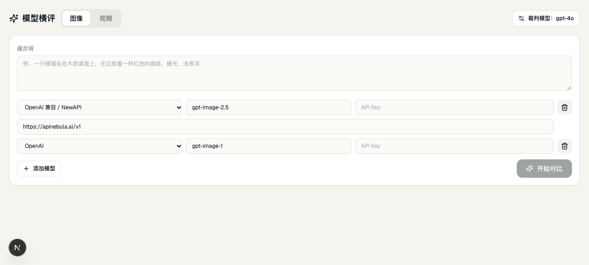

# 模型横评 · Visual Eval Workbench

同一句提示词，同时发给多个图像/视频生成模型，并排看结果，再按统一维度打分对比。

用于回答一个具体问题：**这几家里，哪一家的模型更适合我的场景。**

<p align="center">
  
</p>

## 它做四件事

1. **接模型** —— 填 API Key 即可，内置 9 家图像 + 3 家视频供应商，任意 OpenAI 兼容接口也能接
2. **并行跑** —— 一条提示词同时发给所有勾选的模型，谁先返回先出图
3. **并排看** —— 结果同屏展示，带耗时，失败的会显示具体错误
4. **自动打分** —— 视觉大模型按 10 个维度逐项评分并给评语，最高分自动高亮

不需要题库，不需要登录，不需要数据库。

## 快速开始

```bash
npm install
./start.sh          # http://localhost:3000
```

打开首页，右上角填「裁判模型」（一个**支持视觉**的 OpenAI 兼容接口）：

```
Base URL   https://api.openai.com/v1
模型        gpt-4o / qwen-vl-max / doubao-vision-pro ...
API Key    sk-...
```

然后在模型槽里填各家生成的 Key，写一句提示词，点「开始对比」。

> 裁判模型用于打分，和被测模型是两回事。它只读图和提示词，不生成。

## 评测维度

一套维度同时适用图像和视频，口径取自 GenEval、T2I-CompBench、VBench 的公开定义。

| 维度 | 判定什么 | 图 | 视 |
|---|---|:--:|:--:|
| 提示词遵循 | 要求的元素是否齐全，有无跑题或多画 | ✓ | ✓ |
| 主体一致性 | 人物/物体长相是否稳定、与描述相符 | ✓ | ✓ |
| 属性准确 | 颜色、材质、形状是否绑在正确物体上 | ✓ | ✓ |
| 数量准确 | 个数对不对 | ✓ | ✓ |
| 空间站位 | 左右、上下、前后关系是否符合描述 | ✓ | ✓ |
| 动作关系 | 谁对谁做了什么，交互是否成立 | ✓ | ✓ |
| 画面质量 | 畸变、模糊、噪点、文字乱码 | ✓ | ✓ |
| 美学表现 | 构图、光影、色彩 | ✓ | ✓ |
| 运动自然度 | 动作是否流畅，有无僵硬穿模 | — | ✓ |
| 时序稳定 | 有无闪烁、抖动、背景乱变 | — | ✓ |

1–5 分整数。3 分 = 基本做到但有明显瑕疵，5 分 = 无可挑剔。

维度定义和每项的评分指引在 [`lib/eval-dims.ts`](lib/eval-dims.ts)，想改口径只改这一个文件。

**视频不是逐帧发的**：按时长均匀取 6 帧，用 ffmpeg 拼成 3×2 网格图（带时间戳）再送裁判模型。
成本低 5 倍，时序判断反而更稳。

## 两种打分方式

| | AI 打分（首页） | 客观指标（`/advanced`） |
|---|---|---|
| 引擎 | 多模态大模型，用你的 Key | VBench + pyiqa，本地跑 |
| 擅长 | 语义：画对了没有、位置对不对 | 技术：清晰度、噪声、闪烁、跨帧稳定性 |
| 输出 | 1–5 分 + 每维评语 | 原始数值，不归一化 |
| 成本 | 按 token 计费 | 免费 |
| 可复现 | 有随机性 | 确定性 |

`/advanced` 保留了完整的题库工作台（42 道图像题、18 道视频题、人工 1–5 分、提示词库、历史记录）。
它的客观指标需要单独起 Python 服务：

```bash
cd ../eval-suite && ./bin/evalctl score-server --port 7861
```

没有这个服务时，`/advanced` 仍可用（人工打分正常），只是客观指标位置显示提示。

## 目录

```
app/
  page.tsx                  横评首页
  advanced/page.tsx         完整题库工作台
  api/generate-images/      9 家图像供应商接入
  api/generate-videos/      3 家视频供应商接入（异步任务 + 轮询）
  api/ai-score/             AI 打分（含 ffmpeg 抽帧）
  api/score/                客观指标代理（→ 本地 Python 服务）
components/
  SimpleBench.tsx           横评界面
  PromptLibrary.tsx         提示词库
  BenchWorkbench.tsx        图像工作台（题库）
  VideoWorkbench.tsx        视频工作台（题库）
lib/
  eval-dims.ts              10 维评测体系
  provider-config.ts        图像供应商配置
  video.ts                  视频供应商配置
  prompt-library.ts         提示词库读写（IndexedDB）
  db.ts                     统一的 IndexedDB 连接
```

## 已知限制

1. **AI 打分是主观的。** 同一素材重复评分可能相差约 1 分。要稳定结论就多跑几次取平均。
2. **不等于学术 benchmark。** GenEval 用目标检测器数物体、T2I-CompBench 用检测框算几何关系，是确定性的；而 detectron2 / UniDet 在 arm64 macOS 上无法构建，这里改用视觉语言模型替代。结论方向一致，数值不可对标论文。
3. **视觉模型能力决定上限。** 换成 7B 级小模型后，"空间站位""数量准确"这类细粒度判断会明显变差。
4. **厂商视频 URL 约 24 小时过期。** 打过分的素材会缓存在 `.data/`，没打分的过期后播放不了。
5. **Key 只存在本机浏览器**（localStorage），不上传任何服务器。

## 致谢与许可

本项目基于 [magau123/ImageBench](https://github.com/magau123/ImageBench) 改造，
后者又源自 [vercel-labs/ai-sdk-image-generator](https://github.com/vercel-labs/ai-sdk-image-generator)。

改造部分：新增极简横评页面与 AI 打分链路、10 维评测体系、提示词库；
保留上游全部供应商接入与题库工作台。详见 [OBJECTIVE-SCORING.md](OBJECTIVE-SCORING.md)。
上游原始 README 存档于 [README.upstream.md](README.upstream.md)。

Apache License 2.0，与上游一致。
